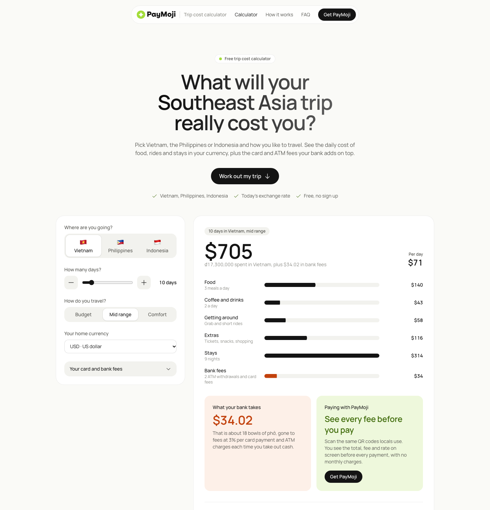

# PayMoji trip cost calculator

**Live:** https://paymoji-trip-cost.netlify.app

A free calculator for travellers planning Vietnam, the Philippines or Indonesia. Pick a country, the number of days and a travel style, and it shows the daily cost of food, rides and stays in your home currency, plus what your bank takes in card and ATM fees.



## What it does

- Daily costs for budget, mid range and comfort travel in each country
- Bank fees worked out from your card's foreign transaction fee, your ATM fee and the local ATM fee, all editable
- Today's market exchange rate for 16 home currencies, with a built in fallback
- A share link that opens the same trip

## How it works

One static `index.html` with no framework and no backend. Exchange rates come from [open.er-api.com](https://open.er-api.com). Prices and fees live in the `COUNTRIES` and `PAYMOJI` settings at the top of the script.

## Run it locally

Open `index.html` in a browser, or:

```
python3 -m http.server 8000
```

Made for [PayMoji](https://www.paymoji.app/), the travel wallet for Southeast Asia.
